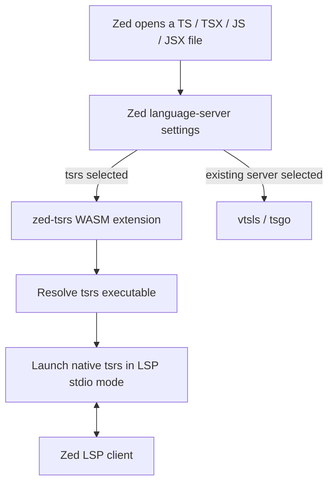

# Zed TSRS Extension — Implementation Plan

> **Status:** Adapter, managed binaries, settings, tests and CI implemented; manual acceptance checks pending (see [validation status](validation.md)). Original milestone checklists below are retained as acceptance criteria, not claims of completed verification.  
> **Scope:** Independent Zed extension integrating the `tsrs` TypeScript/JavaScript language server.  
> **Reference implementation:** [`zed-extensions/tsgo`](https://github.com/zed-extensions/tsgo)  
> **Upstream server:** [`oxc-project/tsrs`](https://github.com/oxc-project/tsrs)

## 1. Objective

Build a small, maintainable Zed extension named **`zed-tsrs`** that launches `tsrs` as a native Language Server Protocol (LSP) process for TypeScript, TSX, JavaScript, and JSX.

The extension must be **opt-in** so existing projects remain on their currently configured language servers (for example, `vtsls` or `tsgo`). Developers should be able to enable `tsrs` **per project** without running `vtsls` for those same file types. TypeScript 6 projects may opt in experimentally even though `tsrs` tracks the native TypeScript 7 implementation; compatibility is not guaranteed.

### Goals

- Keep `tsrs` independent from the existing Zed `tsgo` extension.
- Register the server for TypeScript, TSX, JavaScript, and JSX.
- Support explicit per-project and global opt-in.
- Resolve a user-specified binary before other options.
- Start with a locally installed executable; add automatic installation later.
- Reuse relevant patterns from the Zed `tsgo` extension.
- Keep the extension-side Rust/WASM code focused on resolving and launching the server, not implementing LSP itself.

### Non-goals for the MVP

- Automatic switching between `vtsls`, `tsgo`, and `tsrs` based on project TypeScript version.
- LSP proxying or embedding the `tsrs` compiler into extension WASM.
- Reimplementing Tree-sitter grammars already provided by Zed.
- Promising feature parity or exact TypeScript 6 semantics.

## 2. Architecture



**Responsibility boundary:** Zed decides which language servers are active. The extension resolves the executable, arguments, and environment, and returns the command for Zed to launch. It does not manage `vtsls` or force it to stop globally.

### Architectural decisions

| Area | Decision |
|---|---|
| Project name | `zed-tsrs` |
| Extension ID / language server ID | `tsrs` (verify no conflict before publishing) |
| Implementation language | Rust, compiled to Zed's WASM target |
| Reference | `zed-extensions/tsgo` |
| Languages | TypeScript, TSX, JavaScript, JSX |
| Activation | Opt-in, preferably scoped to `.zed/settings.json` |
| Binary source, MVP | Explicit configured path or PATH |
| Binary source, later | Managed installation of `tsrs` npm/native distribution |
| TypeScript 6 | Experimental manual opt-in |
| Automatic TS-version detection | Deferred |

## 3. Proposed repository structure

Keep the first iteration minimal. Split files only when responsibilities become large enough to justify it.

```text
zed-tsrs/
├── .github/
│   └── workflows/
│       └── ci.yml
├── src/
│   ├── lib.rs
│   ├── binary.rs           # Fase 2 (optional in MVP)
│   ├── installer.rs        # Fase 2
│   ├── platform.rs         # Fase 2
│   └── settings.rs         # Fase 3, if warranted
├── Cargo.toml
├── Cargo.lock
├── extension.toml
├── LICENSE
└── README.md
```

Reuse or adapt from `tsgo`:

| Component | Plan |
|---|---|
| `language_server_command` | Adapt to `tsrs` CLI and binary settings |
| `LspSettingsWithFallback` patterns | Adapt if useful; avoid inherited `tsgo` fallback assumptions |
| Package installation and caching | Reuse approach, not hard-coded package names |
| Platform/architecture detection | Adapt to `tsrs`' actual published artifacts |
| Initialization options | Copy only after validating support in `tsrs` |
| Workspace configuration | Copy only after validating support in `tsrs` |
| JSON merge helpers | Reuse if still necessary |

## 4. Phase 1 — Minimal LSP integration (v0.1.0)

**Outcome:** `tsrs` launches for files whose Zed settings explicitly select it, using an existing local executable.

### Tasks

- [ ] Fork or copy the appropriate files from [`zed-extensions/tsgo`](https://github.com/zed-extensions/tsgo), retaining required attribution and license notices.
- [ ] Create new extension metadata (`id`, name, description, repository URL).
- [ ] Register TypeScript, TSX, JavaScript, and JSX as supported languages.
- [ ] Declare opt-in language behavior in the manifest, after validating the target Zed extension API/schema.
- [ ] Map Zed language names to LSP language IDs (`typescript`, `typescriptreact`, `javascript`, `javascriptreact`) where required.
- [ ] Implement the `zed::Extension` entry point and `language_server_command`.
- [ ] Resolve a user-selected executable or the `tsrs` binary on PATH.
- [ ] Verify the CLI's exact LSP arguments against the installed version (`--lsp -stdio` is currently documented; do not assume `--stdio` is interchangeable).
- [ ] Install as a local development extension in Zed.
- [ ] Verify initialization, completion, hover, diagnostics, and clean shutdown.

### Proposed manifest (validate against current Zed schema)

```toml
id = "tsrs"
name = "TSRS Language Server"
description = "TypeScript language server powered by tsrs"
version = "0.1.0"
schema_version = 1
authors = ["Luan Roger"]
repository = "https://github.com/<owner>/zed-tsrs"

[language_servers.tsrs]
name = "TSRS"
languages = ["TypeScript", "TSX", "JavaScript", "JSX"]
opt_in_languages = ["TypeScript", "TSX", "JavaScript", "JSX"]

[language_servers.tsrs.language_ids]
TypeScript = "typescript"
TSX = "typescriptreact"
JavaScript = "javascript"
JSX = "javascriptreact"
```

> Check whether the selected Zed extension API accepts all of these manifest keys before relying on them. In particular, confirm the `opt_in_languages` behavior against the current schema and published extension examples.

### Minimal Rust entry point (illustrative)

```rust
use zed_extension_api::{self as zed, Command, LanguageServerId, Result, Worktree};

struct TsrsExtension;

impl zed::Extension for TsrsExtension {
    fn new() -> Self {
        Self
    }

    fn language_server_command(
        &mut self,
        _id: &LanguageServerId,
        worktree: &Worktree,
    ) -> Result<Command> {
        let executable = worktree
            .which("tsrs")
            .ok_or("tsrs executable not found in PATH")?;

        Ok(Command {
            command: executable,
            args: vec!["--lsp".into(), "-stdio".into()],
            env: Default::default(),
        })
    }
}

zed::register_extension!(TsrsExtension);
```

This is a starting point rather than a guaranteed drop-in implementation: adjust imports, manifest requirements, and build target to the current Zed extension SDK. Add explicit binary-path support as the next small change.

### Per-project opt-in example

Create `.zed/settings.json` **only** in the project that should use `tsrs`:

```json
{
  "languages": {
    "TypeScript": { "language_servers": ["tsrs"] },
    "TSX": { "language_servers": ["tsrs"] },
    "JavaScript": { "language_servers": ["tsrs"] },
    "JSX": { "language_servers": ["tsrs"] }
  }
}
```

Using only `"tsrs"` intentionally excludes other language servers **for those languages in that project**. If the user includes `"..."`, Zed may also start its default servers; if the user explicitly adds `vtsls`, both can run. Other projects and workspaces remain unaffected.

### Phase 1 acceptance criteria

- [ ] Extension loads as a development extension.
- [ ] `tsrs` does not start unless selected.
- [ ] `tsrs` initializes with a valid local binary.
- [ ] Completion, hover, and diagnostics work in a test TypeScript project.
- [ ] `vtsls` does not start for files configured with the exclusive `"tsrs"` server list.
- [ ] Existing projects not opting in are unaffected.

## 5. Phase 2 — Binary management (v0.2.0)

**Outcome:** Users can install the extension without manually preparing a native executable on supported platforms.

### Tasks

- [ ] Support `lsp.tsrs.binary.path` as the highest-priority explicit override.
- [ ] Support a configurable binary environment if exposed by the current Zed settings API.
- [ ] Check PATH for an existing `tsrs` executable.
- [ ] Determine how the `tsrs` npm package resolves its platform-specific native binaries.
- [ ] Map OS/architecture to the actual supported `tsrs` distribution artifacts.
- [ ] Implement download/installation and cache reuse using the established Zed extension patterns.
- [ ] Add package-version pinning, rather than silently upgrading every time.
- [ ] Ensure any runtime assets required by `tsrs` (including standard library files, where applicable) are available.
- [ ] Report actionable errors for unsupported platforms and failed downloads.

### Binary resolution precedence

```text
1. Explicit configured binary path
2. Executable found in PATH
3. Already cached managed installation
4. Download/install managed release
5. Actionable error
```

Always validate the executable and confirm the command-line flags for the selected package version. Do not assume `tsgo`'s `@typescript/typescript-*` package layout matches the `tsrs` distribution.

### Phase 2 acceptance criteria

- [ ] A fresh Zed environment can start `tsrs` without a separately installed global binary.
- [ ] An explicit binary path takes precedence.
- [ ] A pinned version remains pinned across launches.
- [ ] Installation is not repeated unnecessarily.
- [ ] Windows, Linux, and macOS installations are tested for supported architectures.

## 6. Phase 3 — Settings and compatibility (v0.3.0)

**Outcome:** Reliable configuration and clear behavior across existing TypeScript projects.

### Tasks

- [ ] Support both global Zed settings and project-specific `.zed/settings.json`.
- [ ] Expose or document an optional version setting for the managed `tsrs` package.
- [ ] Forward supported LSP initialization options.
- [ ] Forward supported workspace settings.
- [ ] Validate whether `tsgo`'s inlay-hint and other initialization settings apply unchanged to `tsrs`.
- [ ] Document TypeScript 6 as experimental, without claiming behavioral compatibility.
- [ ] Explain exclusive language-server selection so that users do not unintentionally run `vtsls` alongside `tsrs`.
- [ ] Test pnpm/npm/yarn projects, including monorepos.

### Example settings after managed installation exists

```json
{
  "languages": {
    "TypeScript": { "language_servers": ["tsrs"] },
    "TSX": { "language_servers": ["tsrs"] },
    "JavaScript": { "language_servers": ["tsrs"] },
    "JSX": { "language_servers": ["tsrs"] }
  },
  "lsp": {
    "tsrs": {
      "settings": {
        "package_version": "<pinned-tsrs-version>"
      }
    }
  }
}
```

`package_version` in this example is an **extension-defined convention to implement**, not an established `tsrs` protocol setting. Only document this JSON as supported after the extension actually reads it.

## 7. Phase 4 — Testing, CI, and release

### Test matrix

| Scenario | Expected behavior |
|---|---|
| TS 6, default Zed configuration | Existing LSP continues unchanged |
| TS 6, manual `tsrs` opt-in | Server starts; limitations are documented |
| TS 7+, manual `tsrs` opt-in | Server starts and supported LSP features work |
| TSX / JSX | Correct LSP language ID and diagnostics |
| No binary, Phase 1 | Clear missing-binary error |
| No binary, Phase 2+ | Managed installation succeeds where supported |
| Custom binary | Override wins over PATH/cache |
| Project A uses `tsrs`, Project B uses `vtsls` | Each uses its selected server |
| `language_servers: ["tsrs"]` | No `vtsls` for the same file type in that project |
| pnpm monorepo | Workspace and module resolution behave as expected |
| Unsupported platform | Clear error; no broken installation |

### CI checklist

- [ ] `cargo fmt --check`
- [ ] `cargo clippy` for the supported target/configuration
- [ ] Build extension WASM with the toolchain/target required by the current Zed SDK
- [ ] Unit tests for platform/package resolution and settings precedence
- [ ] Integration smoke tests against an installed `tsrs` binary
- [ ] Platform-specific installation checks
- [ ] README with setup, opt-in, troubleshooting, and known limitations
- [ ] Attribution, compatible license, and release notes

## 8. Future enhancement — Automatic TypeScript-version selection

Consider a future policy with three user-facing choices:

- **Default / off:** keep Zed's existing TypeScript LSP.
- **On:** explicitly use `tsrs`, regardless of project TypeScript version.
- **Auto:** prefer `tsrs` for supported TypeScript versions; otherwise use the existing LSP.

Potential default *policy* for automatic mode:

| Detected TypeScript version | Suggested server | Manual override |
|---|---|---|
| <= 5 | Existing LSP | Yes |
| 6 | Existing LSP | Yes |
| >= 7 | `tsrs` | Yes |
| Unknown | Existing LSP | Yes |

Detection should inspect the **resolved/installed** TypeScript version rather than relying solely on the dependency range in `package.json`, and must account for monorepo package boundaries.

**Important constraint:** Zed's extension opt-in setting is not, by itself, a dynamic switch between independently registered language servers. Before implementing `auto`, verify whether the current extension API can influence language-server selection per worktree. If not, keep manual opt-in or propose an upstream Zed enhancement; do not build an unreliable process-swapping workaround.

## 9. Release roadmap

| Version | Milestone | Exit condition |
|---|---|---|
| `v0.1.0` | Minimal integration | Local `tsrs`, opt-in, basic LSP features |
| `v0.2.0` | Managed binaries | Install/reuse native binary with explicit overrides |
| `v0.3.0` | Compatibility and quality | Configuration, CI, monorepos, platform tests |
| `v1.0.0` | Stable integration | Reliable installation and documented supported behavior |
| Future | Version-aware selection | Only if the Zed API supports robust automatic switching |

## 10. Definition of done for the initial MVP

- [ ] Compiles for the WASM target required by the Zed extension SDK.
- [ ] Registers the `tsrs` server and desired languages.
- [ ] Is opt-in rather than silently taking over existing projects.
- [ ] Starts a native `tsrs` executable with verified LSP stdio flags.
- [ ] Supports at least basic diagnostics, completion, hover, and navigation.
- [ ] Can be activated exclusively through project settings.
- [ ] Does not interfere with a separate project using `vtsls`.
- [ ] Has installation and troubleshooting instructions.

## 11. Implementation order

1. **Build the thinnest possible adapter** around `language_server_command`.
2. **Verify end-to-end LSP behavior** against a pinned local `tsrs` version.
3. **Implement binary overrides** and then managed installation.
4. **Harden per-project configuration**, errors, and compatibility notes.
5. **Add comprehensive testing and publish** after validating the published Zed extension API.
6. **Revisit automatic selection** only when supported reliably.

## References

- [Zed `tsgo` extension](https://github.com/zed-extensions/tsgo)
- [`tsrs` repository](https://github.com/oxc-project/tsrs)
- [Cloudflare — TypeScript Rust port](https://blog.cloudflare.com/typescript-rust-port/)
- [Zed extension development](https://zed.dev/docs/extensions/developing-extensions)
- [Zed language extensions](https://zed.dev/docs/extensions/languages)

---

**Guiding principle:** preserve existing Zed behavior by default. Make `tsrs` an explicit, well-isolated choice that can evolve with the upstream server.
